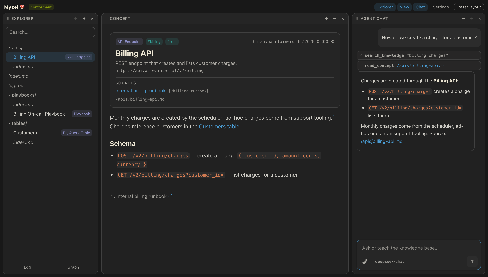
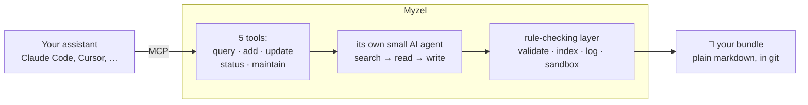

<div align="center">

# Myzel 🍄

**Your assistants forget. Myzel remembers.**

A self-organizing knowledge network for your AI tools, kept as plain markdown you own.

[](https://github.com/medienlampe/Myzel/actions/workflows/ci.yml)
[](https://github.com/medienlampe/Myzel/actions/workflows/ci.yml)
[](https://github.com/medienlampe/Myzel/actions/workflows/docker.yml)
<br>
[](LICENSE)
[](package.json)
[](https://github.com/GoogleCloudPlatform/knowledge-catalog/blob/main/okf/SPEC.md)
[](#connect-your-assistant)
[](https://github.com/thecodacus/understory)

[Quick start](#quick-start) · [Connect](#connect-your-assistant) · [How it works](#how-it-works) · [Docs](#documentation)

</div>

---

_Myzel_ is German for mycelium, the fungal network under the forest floor that lets trees pass
things along to each other. This one does the same for your AI tools. Explain something to Claude
Code on Monday and Cursor knows it on Tuesday.

Under the hood it's a folder of markdown files. Every assistant you connect reads from it and writes
to it. A small agent of Myzel's own does the filing: it puts new facts where they belong, links them
to related ones and throws out whatever they contradict.

- Works with anything that speaks MCP.
- Plain files. Open them in your editor, `grep` them, keep them in git. Walk away whenever you like.
- Runs on whatever model you give it. A cheap API or a local model is plenty.

<p align="center">
  
</p>

> [!NOTE]
> Myzel began as a fork of [understory](https://github.com/thecodacus/understory) by
> [@thecodacus](https://github.com/thecodacus). More in [Where it came from](#where-it-came-from).

## Quick start

You need [Docker](https://docs.docker.com/get-started/get-docker/) with Compose and an API key for a
language model ([which one?](#pick-a-model)). No need to clone anything.

**1.** In an empty folder, save this as `docker-compose.yml`:

```yaml
services:
  myzel:
    image: ghcr.io/medienlampe/myzel:latest
    ports:
      - "127.0.0.1:3800:3800" # this machine only
    volumes:
      - myzel-memory:/bundle # or a folder you can see: ./my-memory:/bundle
      - myzel-config:/config # settings changed in the web UI
    environment:
      BUNDLE_ROOT: /bundle
      LLM_API_BASE_URL: ${LLM_API_BASE_URL}
      LLM_API_KEY: ${LLM_API_KEY}
      LLM_API_FORMAT: openai
      LLM_MODEL: ${LLM_MODEL:-}
      ADMIN_TOKEN: ${ADMIN_TOKEN:-} # optional: enables the settings page
    restart: unless-stopped

volumes:
  myzel-memory:
  myzel-config:
```

**2.** Put your model settings next to it in `.env` (here with
[DeepSeek](https://platform.deepseek.com/)):

```bash
LLM_API_BASE_URL=https://api.deepseek.com/v1
LLM_API_KEY=sk-...
LLM_MODEL=deepseek-chat
```

**3.** Start it:

```bash
docker compose up -d
docker compose logs myzel | tail -3
# Myzel serving bundle /bundle on 0.0.0.0:3800 (web + /api + /mcp)
```

**4.** Open **[http://localhost:3800](http://localhost:3800)**.

> [!TIP]
> The memory starts out empty. Tell the chat _"We deploy on Fridays, never Mondays."_, open the
> graph and watch a new dot appear. Tell it something related and watch the two get linked.

Stuck? Try [Troubleshooting](docs/running.md#troubleshooting).

## Connect your assistant

Claude Code:

```bash
claude mcp add --transport http myzel http://localhost:3800/mcp
```

Anything else: add `http://localhost:3800/mcp` as a _streamable HTTP_ server and restart the
client. Your assistant gets five tools:

| Tool | What it does |
|---|---|
| `memory_query` | Ask a question, get an answer. |
| `memory_add` | Teach it something. Myzel files it and links it. |
| `memory_update` | Correct something. The old version goes away. |
| `memory_status` | How many concepts, how many broken links. |
| `memory_maintain` | Tidy up orphans and broken links. |

At the start of each session Myzel also hands the assistant a short summary of what it knows, so
the assistant knows when to ask. stdio and other options are in
[Running Myzel](docs/running.md#other-ways-to-connect).

## Pick a model

Myzel's agent needs a model of its own to decide where things go. It doesn't have to be clever or
expensive. It does have to support **tool calling**. Any OpenAI- or Anthropic-compatible API works.

| Provider | `LLM_API_BASE_URL` | `LLM_MODEL` |
|---|---|---|
| DeepSeek | `https://api.deepseek.com/v1` | `deepseek-chat` |
| OpenAI | `https://api.openai.com/v1` | `gpt-4o` |
| Anthropic | `https://api.anthropic.com/v1` | `claude-sonnet-5` (plus `LLM_API_FORMAT=anthropic`) |
| llama.cpp | `http://host.docker.internal:8080/v1` | _leave empty, Myzel asks the server_ |

More providers and a fallback model: [Configuration](docs/configuration.md#model-providers).

## The web UI

Three panels:

- **Explorer:** your files as a tree, with search.
- **View:** the open file, the log or the graph. Red-ringed dots in the graph are orphans nobody
  links to yet.
- **Chat:** talk to Myzel's agent and watch every step. Attach text files, stop a run, retry it.

Drag a title bar to move a panel, drag a border to resize it. Your browser remembers the layout.

Set `ADMIN_TOKEN` and a **Settings** page lets you change the model, timeouts, caches and more
without touching a file ([details](docs/configuration.md#the-settings-page)). Want to show Myzel
off without anyone scribbling in it? [Demo mode](docs/running.md#demo-mode) is read-only:
`make demo`.

## How it works



A memory is a folder (a **bundle**) with one markdown file per **concept**, in the open
[OKF](https://github.com/GoogleCloudPlatform/knowledge-catalog/blob/main/okf/SPEC.md) format.
Concepts link to each other, which turns the whole thing into a graph.

The model decides _what_ to change. Plain code makes sure the result is valid and keeps `index.md`
and `log.md` up to date. The model can't break the format even if it tries.

Repeated questions come from a cache, recent ones from hot memory. Optional **dreaming** tidies the
graph on a schedule. Every run can be **replayed** on the graph, so you can see how Myzel got to its
answer. More in [How it works](docs/how-it-works.md).

## Running it safely

Anyone who can reach the port can read _and change_ the memory. Out of the box Myzel listens on
localhost only and refuses browser requests from other sites, so on your own machine you're fine.

- Before you open it to a network, **set `AUTH_TOKEN`** (`openssl rand -hex 24`).
- Several people or projects? Give each their own memory and key with
  [profiles](docs/running.md#profiles-several-memories-on-one-server).

Reverse proxies, rate limits and prompt injection: [Running Myzel](docs/running.md).

## Development

You need **Node 24+** and **pnpm 10.34.6** (`corepack enable` picks the right one).

```bash
cp .env.example .env   # add your model settings
make start             # build and serve on http://localhost:3800
make dev               # live reload, web UI on http://localhost:5180
make check             # everything CI runs
make help              # the rest
```

`make` works on `demo-bundle/`, a throwaway copy of the [sample memory](sample-bundle). Point
`BUNDLE_ROOT` elsewhere if you want.

Tests build real bundles in temp folders and talk to a fake model, never a real provider. Coverage
below 80% fails the build.

Want to contribute? Read [AGENTS.md](AGENTS.md) first. It lists the rules the code relies on.

## Documentation

| Page | For |
|---|---|
| [Running Myzel](docs/running.md) | Connecting, exposing it safely, auth, profiles, troubleshooting |
| [Configuration](docs/configuration.md) | Model providers and every environment variable |
| [How it works](docs/how-it-works.md) | The memory format, memory layers, graph health, dreaming, replay |
| [Architecture](docs/architecture.md) | The code: packages, write path, agent, server, web UI |
| [Security](docs/security.md) | Threat model, defenses and known limitations |
| [Maintenance](docs/maintenance.md) | Pinned versions and how to upgrade them |

## Where it came from

Myzel started as a fork of [understory](https://github.com/thecodacus/understory) by
[@thecodacus](https://github.com/thecodacus), who had the idea and built the original. The fork
happened after understory's dreaming feature
([#9](https://github.com/thecodacus/understory/pull/9)) and the two have gone separate ways since.
What changed most:

- **Security.** Localhost by default, DNS rebinding protection, rate limits, defenses against prompt
  injection and a git autocommit that doesn't trust the bundle's `.git`. See
  [Security](docs/security.md).
- **OKF v0.2** instead of v0.1.
- **YAML-only frontmatter.** understory's parser would happily run a `---js` block. Myzel refuses it.
- **New stuff:** a settings page, a read-only demo mode, panels you can rearrange and file uploads in
  the chat. Plus a fresh coat of Solarized paint, light and dark.
- **Fresh dependencies** (AI SDK 7, Zod 4, TypeScript 6, Node 24) and a CI that fails below 80%
  test coverage.

Good fixes from upstream still find their way over now and then.

## License

[Apache 2.0](LICENSE), same as upstream. The bundle format is the
[Open Knowledge Format v0.2](https://github.com/GoogleCloudPlatform/knowledge-catalog/blob/main/okf/SPEC.md),
an open standard by Google Cloud Platform.
