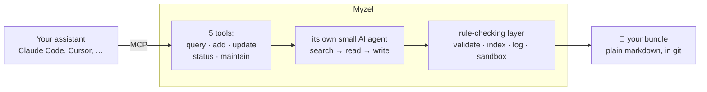

<div align="center">

# Myzel 🍄

**Your assistants forget. Myzel remembers.**

A self-organizing knowledge network for your AI tools, kept as plain markdown you own.

[](https://github.com/medienlampe/Myzel/actions/workflows/ci.yml)
[](https://github.com/medienlampe/Myzel/actions/workflows/ci.yml)
[](https://github.com/medienlampe/Myzel/actions/workflows/docker.yml)
<br>
[](LICENSE)
[](package.json)
[](https://github.com/GoogleCloudPlatform/knowledge-catalog/blob/main/okf/SPEC.md)
[](#connect-your-assistant)
[](https://github.com/thecodacus/understory)

[Quick start](#quick-start) · [Connect](#connect-your-assistant) · [How it works](#how-it-works) · [Docs](#documentation)

</div>

---

_Myzel_ is German for mycelium: the network under the forest floor that connects the trees and
carries what they need from one to the next. This is that network for your AI tools. Every
assistant you connect writes into the same web of linked notes, and every one can draw from it, so
what you explained to Claude Code yesterday is something Cursor already knows today.

- **One memory, every client:** anything that speaks MCP can connect: Claude Code, Claude Desktop,
  Cursor and more.
- **Files, not a database:** each fact is a markdown file. Open it in your editor, `grep` it, review
  changes in git. If you ever stop using Myzel, nothing is locked in.
- **It does the filing:** say _"remember this"_ and Myzel finds where the fact belongs, links it to
  what it relates to and replaces what it contradicts.
- **Runs on a model you pick:** the bookkeeping happens on a model of your choice, so a cheap API or
  a local model on your own machine is plenty.

<p align="center">
  
</p>

> [!NOTE]
> Myzel started as a fork of [**thecodacus/understory**](https://github.com/thecodacus/understory)
> by [@thecodacus](https://github.com/thecodacus), where the idea and the original implementation
> come from. It is now developed independently and ships its own image
> (`ghcr.io/medienlampe/myzel`).

## Quick start

You need [Docker](https://docs.docker.com/get-started/get-docker/) with Compose and an API key for a
language model ([which one?](#pick-a-model)). No need to clone this repo.

**1.** In an empty folder, save this as `docker-compose.yml`:

```yaml
services:
  myzel:
    image: ghcr.io/medienlampe/myzel:latest
    ports:
      - "127.0.0.1:3800:3800" # this machine only
    volumes:
      - myzel-memory:/bundle # or a folder you can see: ./my-memory:/bundle
    environment:
      BUNDLE_ROOT: /bundle
      LLM_API_BASE_URL: ${LLM_API_BASE_URL}
      LLM_API_KEY: ${LLM_API_KEY}
      LLM_API_FORMAT: openai
      LLM_MODEL: ${LLM_MODEL:-}
    restart: unless-stopped

volumes:
  myzel-memory:
```

**2.** Next to it, save your model settings as `.env` (this example uses
[DeepSeek](https://platform.deepseek.com/)):

```bash
LLM_API_BASE_URL=https://api.deepseek.com/v1
LLM_API_KEY=sk-...
LLM_MODEL=deepseek-chat
```

**3.** Start it and check the log:

```bash
docker compose up -d
docker compose logs myzel | tail -3
# Myzel serving bundle /bundle on 0.0.0.0:3800 (web + /api + /mcp)
```

**4.** Open **[http://localhost:3800](http://localhost:3800)**.

> [!TIP]
> The memory starts empty, so teach it something. Tell the chat _"We deploy on Fridays, never
> Mondays."_, open the graph view and watch the new concept appear. Add a related fact and watch
> Myzel link the two.

Something wrong? See [Troubleshooting](docs/running.md#troubleshooting).

## Connect your assistant

For **Claude Code**:

```bash
claude mcp add --transport http myzel http://localhost:3800/mcp
```

For **other MCP clients**, add `http://localhost:3800/mcp` as a _streamable HTTP_ server. Restart
the client afterwards. Your assistant now has five tools:

| Tool | What it does |
|---|---|
| `memory_query` | Ask a question, get an answer in prose. |
| `memory_add` | Teach it something new. Myzel files it in the right place and links it. |
| `memory_update` | Correct something. The outdated version is replaced, not kept next to the new one. |
| `memory_status` | Health check: number of concepts, valid files, broken links. |
| `memory_maintain` | Repair pass: link up orphaned concepts and fix broken links. |

At the start of every session Myzel also sends a short overview of what the memory contains, so the
assistant knows when to look. The stdio transport and other options are in
[Running Myzel](docs/running.md#other-ways-to-connect).

## Pick a model

Myzel does its own thinking: deciding where a fact belongs, what it links to and whether it
contradicts something. That runs on **its own** model, so you can pair an expensive coding assistant
with a cheap or local model here.

Any OpenAI- or Anthropic-compatible API works, as long as the model supports **tool calling**.
DeepSeek is a good cheap default; a local llama.cpp server costs nothing.

| Provider | `LLM_API_BASE_URL` | `LLM_MODEL` |
|---|---|---|
| DeepSeek | `https://api.deepseek.com/v1` | `deepseek-chat` |
| OpenAI | `https://api.openai.com/v1` | `gpt-4o` |
| Anthropic | `https://api.anthropic.com/v1` | `claude-sonnet-5` (plus `LLM_API_FORMAT=anthropic`) |
| llama.cpp | `http://host.docker.internal:8080/v1` | _leave empty: discovered automatically_ |

More providers, local setups and a fallback model: [Configuration](docs/configuration.md#model-providers).

## The web UI

Three panels side by side:

- **Explorer:** your files as a folder tree with search. Its **Log** and **Graph** buttons switch
  what the View panel shows.
- **View:** the open file, the log or the **graph**, where every concept is a dot and every link a
  line. Dots ringed in red are orphans that nothing links to yet.
- **Agent chat:** talk to Myzel's agent directly and watch each step it takes. Markdown is
  formatted as you type (Enter sends, Shift+Enter starts a new line), text files can be attached
  by drag and drop, and a run can be stopped or retried.

Drag a panel's title bar to rearrange the panels (put the chat in the middle, say), drag the borders
to resize and close or reopen panels from the top bar. The **←** / **→** buttons move a panel from
the keyboard and **Reset layout** restores the default. The arrangement is remembered per browser.
The UI uses Solarized colors and follows your system's light or dark setting.

## How it works



- A memory is a folder (a **bundle**) of markdown files, one per **concept**, in the open
  [OKF](https://github.com/GoogleCloudPlatform/knowledge-catalog/blob/main/okf/SPEC.md) format.
  Concepts link to each other, so the memory is a graph.
- The model decides _what_ to change; **plain code guarantees** the result stays valid and keeps
  `index.md` and `log.md` up to date.
- Repeated and recent questions are answered from a **cache** or **hot memory**, without a full
  search.
- Optional **dreaming** tidies the graph on a schedule, and every run can be **replayed** on the
  graph to see why it answered what it did.

The details: [How it works](docs/how-it-works.md).

## Running it safely

The memory is readable _and writable_ by anyone who can reach the port. The defaults are safe for
one machine:

- The server listens on **localhost only**, and browser requests from other websites are refused.
- Before opening it to a network, **set `AUTH_TOKEN`** (`openssl rand -hex 24`).
- Several people or projects? Give each its own memory and key with
  **[profiles](docs/running.md#profiles-several-memories-on-one-server)**.

Exposure, reverse proxies, rate limits and prompt injection: [Running Myzel](docs/running.md).

## Development

Requires **Node ≥ 22.12** and **pnpm 10.34.6** (`corepack enable` picks it up from `package.json`).
The [Makefile](Makefile) wraps the common tasks:

```bash
cp .env.example .env   # add your model settings; make loads this file
make start             # build and serve on http://localhost:3800
make dev               # live reload: server on :3800, web UI on http://localhost:5180
make check             # what CI runs: audit, lint, format check, tests with coverage
make help              # everything else
```

`make` works on `demo-bundle/`, a gitignored copy of the [sample memory](sample-bundle), unless you
set `BUNDLE_ROOT`.

<details>
<summary><b>Without make</b></summary>

```bash
pnpm install && pnpm build
BUNDLE_ROOT=./sample-bundle \
LLM_API_BASE_URL=https://api.deepseek.com/v1 LLM_API_KEY=sk-... LLM_MODEL=deepseek-chat \
node packages/server/dist/index.js

# dev mode, in two terminals
cp -R sample-bundle demo-bundle   # once: a scratch copy the agent may write to
BUNDLE_ROOT="$PWD/demo-bundle" pnpm --filter @myzel/server dev
pnpm --filter @myzel/web dev
```

`docker compose up --build` builds the image from source with this repo's
[docker-compose.yml](docker-compose.yml).

</details>

### Tests

```bash
make test       # 362 tests: core 149, server 137, web 76
make coverage   # the same with coverage; fails if any package drops below 80%
                # (statements, branches, functions, lines); reports in packages/*/coverage/
```

Tests build real bundles in temp directories and never mock the filesystem. No test hits a real
provider: agent runs talk to a scripted fake model over HTTP, so the real provider, fallback and
tool-loop code runs. The web UI is tested with Testing Library against a fake API.

### The packages

| Package | What's in it |
|---|---|
| [`packages/core`](packages/core) | The bundle layer (plain code), the agent, the memory layers and provider setup |
| [`packages/server`](packages/server) | MCP over HTTP and stdio, the browse and chat APIs and profiles; serves the UI |
| [`packages/web`](packages/web) | React web UI: file browser, graph view and chat |

Contributing? Read [AGENTS.md](AGENTS.md) first: it lists the invariants, conventions and sharp
edges.

## Documentation

| Page | For |
|---|---|
| [Running Myzel](docs/running.md) | Connecting, exposing it safely, auth, profiles, troubleshooting |
| [Configuration](docs/configuration.md) | Model providers and every environment variable |
| [How it works](docs/how-it-works.md) | The memory format, memory layers, graph health, dreaming, replay |
| [Architecture](docs/architecture.md) | The code: packages, write path, agent, server, web UI |
| [Security](docs/security.md) | Threat model, defenses and known limitations |
| [Maintenance](docs/maintenance.md) | Pinned versions and how to upgrade them |

## Credits and license

Started as a fork of [thecodacus/understory](https://github.com/thecodacus/understory) by
[@thecodacus](https://github.com/thecodacus), where the design and the original implementation come
from. Development continues independently here.

The bundle format is the
[Open Knowledge Format v0.1](https://github.com/GoogleCloudPlatform/knowledge-catalog/blob/main/okf/SPEC.md),
an open standard published by Google Cloud Platform.

Licensed [Apache 2.0](LICENSE), the same licence it was forked under.
