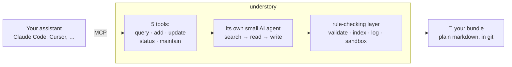

<div align="center">

# understory 🌱

**Memory that grows.**

A long-term memory for your AI assistants — stored as plain markdown files you own.

[](LICENSE)
[](package.json)
[](https://github.com/GoogleCloudPlatform/knowledge-catalog/blob/main/okf/SPEC.md)
[](#connect-your-agent)
[](https://github.com/thecodacus/understory)

[Quick start](#quick-start) · [How it works](#how-it-works) · [Troubleshooting](#troubleshooting) · [Configuration](#configuration)

</div>

---

> [!NOTE]
> **Origin.** This project started as a fork of
> [**thecodacus/understory**](https://github.com/thecodacus/understory) by
> [@thecodacus](https://github.com/thecodacus) — the idea and the original implementation come
> from there.
>
> Development continues independently in this repository, which ships its own container image
> (`ghcr.io/medienlampe/understory`). Expect the two to diverge.

Your AI coding assistant forgets everything when the session ends. Tell it about your deploy process
on Monday, and on Tuesday you explain it again.

understory is a place it can write things down and look them up later. It connects over **MCP** (Model
Context Protocol — the standard that lets AI assistants use external tools), so any MCP-capable client
works: Claude Code, Claude Desktop, Cursor, and others. Your assistant gets five tools — ask the
memory, teach it, correct it, check its health, repair it — and understory takes care of *where* each
fact belongs.

What makes it different from a database: **the memory is just a folder of markdown files.** You can
read it, hand-edit it, search it with `grep`, and track it in git. Nothing is locked in a binary
format, and if you delete understory tomorrow, your knowledge is still sitting there in plain text.

**Runs great on local models** — the model doing this work never has to be an expensive one.

## What the memory looks like

A memory is a directory — a **bundle** — of markdown files. Each file is one **concept**: a thing
worth remembering, with a few structured fields at the top and free prose below.

```
my-memory/
├── index.md            ← generated table of contents
├── log.md              ← generated history of every change
├── apis/
│   └── billing-api.md
├── tables/
│   └── customers.md
└── playbooks/
    └── oncall-billing.md
```

One concept, from the sample bundle in this repo (trimmed):

```markdown
---
type: BigQuery Table
title: Customers
description: 'Core customer dimension table, one row per registered customer.'
tags: [crm, pii]
---
The canonical customer record. Downstream marts join on `customer_id`.
Billing events reference this table from the [Billing API](/apis/billing-api.md).

# Schema
* `customer_id` (STRING, required) — stable UUID
* `email` (STRING) — PII, masked in non-prod
```

That link to `/apis/billing-api.md` is the important part. Concepts point at each other, so the memory
is a **graph**, not a pile of loose notes — and understory maintains those links for you, including
[repairing them](#graph-health--maintenance) when they rot.

`index.md` and `log.md` are written by understory, never by hand.



The file format follows the [Open Knowledge Format (OKF) v0.1 spec](https://github.com/GoogleCloudPlatform/knowledge-catalog/blob/main/okf/SPEC.md),
a small open standard for exactly this kind of markdown knowledge base — so other tools can read your
memory too.

## Contents

- [What you need](#what-you-need) · [Quick start](#quick-start) · [Connect your agent](#connect-your-agent)
- [Choosing a model provider](#choosing-a-model-provider)
- [Troubleshooting](#troubleshooting)
- [How it works](#how-it-works) — [enforced in code](#why-the-files-stay-valid), [memory layers](#memory-layers), [seed memory](#seed-memory), [graph health](#graph-health--maintenance), [dreaming](#dreaming), [query-path replay](#query-path-replay)
- [Configuration](#configuration) · [Security](#security)
- [From source](#from-source) · [Repo layout](#repo-layout) · [Tests](#tests)

## What you need

- **[Docker](https://docs.docker.com/get-started/get-docker/)**, including Compose.
  Check with `docker compose version`.
- **An API key for a language model.** A hosted one (DeepSeek, OpenAI, …) costs cents for typical
  use; a [local model](#choosing-a-model-provider) works too and costs nothing.
- About five minutes.

> [!IMPORTANT]
> **Why does understory need its own API key when my assistant already has a model?**
>
> Because understory does its own thinking. When your assistant says *"remember that we deploy on
> Fridays"*, understory's internal model has to decide: does a concept about deployments already
> exist? Should this be added there, or become a new file? What should it link to? Does it contradict
> something already written?
>
> That work happens inside understory, on **its own** model — which is why you can pair an expensive
> coding assistant with a cheap or fully local model here.

## Quick start

You don't need to clone this repo — the container image is public.

**1.** Create an empty folder and save this as `docker-compose.yml` inside it:

```yaml
services:
  understory:
    image: ghcr.io/medienlampe/understory:latest
    ports:
      # This machine only. See "Network exposure" before opening it up.
      - "127.0.0.1:3800:3800"
    volumes:
      # Your memory lives here. This keeps it in a Docker volume; to keep it in a
      # folder you can see, replace this line with e.g.  - ./my-memory:/bundle
      - understory-memory:/bundle
    environment:
      BUNDLE_ROOT: /bundle
      LLM_API_BASE_URL: ${LLM_API_BASE_URL}
      LLM_API_KEY: ${LLM_API_KEY}
      LLM_API_FORMAT: openai
      LLM_MODEL: ${LLM_MODEL:-}
    restart: unless-stopped

volumes:
  understory-memory:
```

**2.** In the **same folder**, save your model settings as `.env` — Compose picks this file up
automatically. This example uses DeepSeek ([get a key](https://platform.deepseek.com/); [other
providers →](#choosing-a-model-provider)):

```bash
LLM_API_BASE_URL=https://api.deepseek.com/v1
LLM_API_KEY=sk-...
LLM_MODEL=deepseek-chat
```

**3.** Start it:

```bash
docker compose up -d
```

**4.** Check that it came up:

```bash
docker compose logs understory | tail -3
```

You should see a line like:

```
understory serving bundle /bundle on 0.0.0.0:3800 (web + /api + /mcp)
```

If the container exited instead, the log says why — see [Troubleshooting](#troubleshooting).

**→ Now open [http://localhost:3800](http://localhost:3800).** Three things to look at:

- **Explorer** — your markdown files as a folder tree, with search; opened files render for reading.
- **Graph** — every concept as a dot, every link as a line, arranged so related things cluster
  together (like Obsidian's graph view). Drag it around, zoom, click a dot to open that file. Dots
  ringed in red are *orphans*: nothing links to them yet.
- **Chat** — talk to understory's own agent directly, without hooking up an assistant first. Each
  step it takes (searching, reading, writing) appears as you watch.

The three panels are columns you can arrange: **drag a panel's title bar** onto another panel to
move it there (put the chat in the middle, say), drag the lines between columns to resize, and
close or reopen panels from the top bar. The **←** / **→** buttons in each title bar move a panel
from the keyboard, and **Reset layout** restores the default. Your arrangement is remembered in
this browser.

> [!TIP]
> **Try this first.** Your memory starts empty, so teach it something. In the chat, say:
> *"We deploy on Fridays, never Mondays."* Then open the graph view and watch the new concept appear.
> Add a second, related fact and watch understory link the two together.

Deploying with Portainer? Use [docker-compose.portainer.yml](docker-compose.portainer.yml) as a
repository stack.

## Connect your agent

Now hand the memory to your actual assistant. For **Claude Code**:

```bash
claude mcp add --transport http ustory http://localhost:3800/mcp
```

`ustory` is just the label the tools appear under — pick any name you like. For **other MCP clients**,
add `http://localhost:3800/mcp` as a *streamable HTTP* MCP server; consult that client's docs for
where to put it. Restart the client afterwards, so it picks up the new tools.

Your assistant now has these five tools:

| Tool | What it does |
|---|---|
| `memory_query` | Ask the memory a question, get an answer in prose. |
| `memory_add` | Teach it something new. understory decides where it belongs: folded into a file that already covers the topic, or a new file linked to related ones. |
| `memory_update` | Correct something. The outdated version is replaced, not left standing next to the new one. |
| `memory_status` | Health check — how many concepts, are the files valid, are any links broken. |
| `memory_maintain` | Repair pass: connect up concepts nothing links to, fix broken links. Does nothing when the memory is already healthy. |

An assistant that only sees five tool names never thinks to *check* its memory, so understory also
sends it a short summary of what the memory contains at the start of every session — see
[seed memory](#seed-memory).

<details>
<summary><b>Other ways in</b> — running it without the HTTP server, or from the shell</summary>

**stdio transport.** Instead of talking to a running server over HTTP, the client starts understory as
a local process and talks to it over its input/output streams. Needs no auth token, since nothing
touches the network:

```bash
claude mcp add ustory \
  -e BUNDLE_ROOT=/path/to/your/bundle \
  -e LLM_API_BASE_URL=https://api.deepseek.com/v1 \
  -e LLM_API_KEY=sk-... \
  -e LLM_API_FORMAT=openai \
  -e LLM_MODEL=deepseek-chat \
  -- node /path/to/understory/packages/server/dist/mcp/stdio.js
```

**From the shell.** Same agent, no client involved — handy for a quick check that your setup works
(requires a [source checkout](#from-source)):

```bash
BUNDLE_ROOT=./sample-bundle pnpm agent:query  "What do we know about billing?"
BUNDLE_ROOT=./sample-bundle pnpm agent:mutate "Record that we deploy on Fridays"
```

</details>

## Choosing a model provider

Any **OpenAI-compatible** or **Anthropic-compatible** API works — that covers nearly every provider
and every local server. Set `LLM_API_BASE_URL` + `LLM_API_KEY` + `LLM_MODEL`, and set
`LLM_API_FORMAT` to `openai` (the default) or `anthropic`.

**Not sure what to pick?** DeepSeek is a good default: cheap, and strong enough at the tool-calling
this needs.

| Provider | Settings |
|---|---|
| **DeepSeek** | `LLM_API_BASE_URL=https://api.deepseek.com/v1` `LLM_API_KEY=sk-...` `LLM_MODEL=deepseek-chat` |
| **OpenAI** | `LLM_API_BASE_URL=https://api.openai.com/v1` `LLM_API_KEY=sk-...` `LLM_MODEL=gpt-4o` |
| **Anthropic** | `LLM_API_BASE_URL=https://api.anthropic.com/v1` `LLM_API_KEY=sk-ant-...` `LLM_API_FORMAT=anthropic` `LLM_MODEL=claude-sonnet-5` |
| **Groq** | `LLM_API_BASE_URL=https://api.groq.com/openai/v1` `LLM_API_KEY=gsk_...` `LLM_MODEL=llama-3.3-70b-versatile` |
| **Local llama.cpp** | `LLM_API_BASE_URL=http://localhost:8080/v1` `LLM_MODEL=` *(discovered automatically)* |

> [!IMPORTANT]
> The model must support **tool calling** (sometimes called function calling). understory's agent
> works by calling search/read/write tools in a loop, so a model that can't do that will fail or
> produce nothing. Most current models are fine; very small local models often are not.

<details>
<summary><b>Local llama.cpp — full setup</b></summary>

```bash
# on the machine running the model — --jinja is what enables OpenAI-style tool calling
llama-server -m model.gguf --jinja --host 0.0.0.0 --port 8080

# on the understory side — no model id needed, it's discovered from the endpoint
LLM_API_BASE_URL=http://inference-box:8080/v1 LLM_API_FORMAT=openai LLM_MODEL= \
BUNDLE_ROOT=./sample-bundle node packages/server/dist/index.js
```

Works behind llama-swap too: discovery prefers the model that is currently **loaded**, so a query
doesn't trigger a multi-minute model swap. Pin one explicitly with `LLM_MODEL=`.

</details>

<details>
<summary><b>Fallback model</b> — e.g. a local model with a hosted backup</summary>

Set the matching `LLM_FALLBACK_*` variables. The fallback takes over when the primary model fails
with an error worth retrying (a timeout, or a 5xx). `LLM_FALLBACK_ALLOW_FOR=query` restricts it to
read-only operations, so nothing gets written by the backup model.

```bash
LLM_API_BASE_URL=http://localhost:8080/v1 LLM_MODEL= \
LLM_FALLBACK_API_BASE_URL=https://api.deepseek.com/v1 \
LLM_FALLBACK_API_KEY=sk-... LLM_FALLBACK_MODEL=deepseek-chat
```

</details>

> [!NOTE]
> The older `LLM_PROVIDER` + per-provider key variables (`DEEPSEEK_API_KEY`, `LLAMACPP_BASE_URL`, …)
> still work and are translated automatically, but are **deprecated** — prefer the `LLM_API_*` ones.

## Troubleshooting

Start with `docker compose logs understory`. Most failures print exactly what is missing.

| What you see | What it means |
|---|---|
| `BUNDLE_ROOT env var is required` | The `BUNDLE_ROOT` setting is missing from the `environment:` block. |
| `LLM configuration error: No LLM configured.` | No model settings arrived. Usually the `.env` file isn't next to `docker-compose.yml`, or is named something else. Run `docker compose config` — it prints the values Compose actually resolved. |
| `LLM_MODEL is required for this endpoint.` | Your provider doesn't support automatic model discovery. Set `LLM_MODEL` to a concrete model id. |
| `Model discovery failed: 404` / `No models listed` | `LLM_API_BASE_URL` is probably wrong. It must include the API version path, e.g. `https://api.deepseek.com/v1`, not just the host. |
| `port is already allocated` | Something else uses port 3800. Change the **left** number: `"3900:3800"`, then open `localhost:3900`. |
| Web UI loads but the graph is empty | Expected on a fresh memory — there's nothing in it yet. Teach it a fact in the chat first. |
| Web UI asks for a token | `AUTH_TOKEN` is set; paste that value. See [Auth](#auth). |
| Your assistant has the tools but never uses them | Restart the client after adding the server, so it receives the [seed overview](#seed-memory). Then ask it explicitly once — *"check your memory for what you know about X"*. |
| The agent replies but writes nothing | The model likely doesn't do tool calling well. Try a stronger one — see the note [above](#choosing-a-model-provider). |
| Errors mentioning ambiguous legacy configuration | Old and new variables are both set. Remove the legacy ones and keep `LLM_API_*`. |

## How it works

### Why the files stay valid

The rule that governs the whole design: **correctness is enforced in code, not by asking the model
nicely.**

A language model told "always keep the index up to date" will eventually forget. So understory doesn't
rely on that. A separate, plain-code layer — no AI involved — does the parts that must always hold:
it checks that each file has the required fields, regenerates `index.md`, appends the change to
`log.md`, and refuses any write that would land outside your bundle folder.

The model decides *what* to change. The code guarantees the result is still a valid bundle.

### Memory layers

Not every question deserves a full search. `memory_query` tries three layers in order and stops at
the first one that can answer. Answers from the upper two are labelled in the reply
(`(cached answer)` / `(hot memory)`), so you can always tell what a question actually cost:

| Layer | When it answers | Cost |
|---|---|---|
| **1. Exact cache** | The same question was asked before, and nothing in the memory has changed since. | Free — no model call |
| **2. Hot memory** | The answer is in the handful of concepts written and questions asked recently — a short-term working set, checked with one cheap model call. | One small call |
| **3. Deep memory** | Anything else: search the memory, read the relevant files, answer. | A full agent run |

Both upper layers are on by default; tune them with `QUERY_CACHE*` / `HOT_MEMORY*`.

<details>
<summary>How the cache knows the memory changed</summary>

Rather than hooking into the write path, the cache compares a fingerprint of the bundle — the path,
modification time, and size of every concept file. Any write moves the fingerprint and invalidates
every cached answer, which means edits made *outside* understory (by hand, or by another client) are
picked up as well. Two different edits within the same millisecond that leave the file size identical
are the one case it can miss.

</details>

### Seed memory

An assistant that only sees five bare tool names never gets the instinct to check its memory. So at
**session start** understory hands it a compact overview of what the knowledge base contains —
folders, concepts with their types and descriptions, recent activity — through both channels that
reach the model:

1. the MCP `instructions` field sent during connection setup (clients like Claude put it in the
   system prompt), and
2. the description of the `memory_query` tool itself — the universal fallback, since every
   tool-calling client loads tool descriptions.

The overview is regenerated for every new session. In a long-lived stdio session, it also refreshes
after `memory_add` / `memory_update`, so the session sees its own writes. Edits from elsewhere are
picked up at the next session.

### Graph health & maintenance

Memory is a graph, not a pile of notes, and graphs rot. Two things go wrong over time: a concept
becomes **orphaned** (nothing links to it, so nothing will ever lead the agent to it), and a link goes
**broken** (it points at a file that no longer exists). Two mechanisms counter that:

- **Linking at write time** — a new fact either enriches the concept it belongs to (an attribute of a
  thing that already has a file gets added there, not filed separately), or, when it really is a
  distinct thing, gets its own file *and* links back from related concepts. A fact that contradicts
  an existing one replaces it, rather than sitting next to it.
- **`memory_maintain`** — a plain-code check finds the orphans and broken links (they're also in
  `memory_status` under `graph`), then hands them to the agent to wire up and repair. Run it now and
  then; it does nothing when there's nothing wrong.

### Dreaming

What `memory_maintain` does when asked, dreaming does on a schedule — consolidation while nobody's
looking, the way a brain works during sleep. It is **off by default**; switch it on with
`DREAM_INTERVAL=6h`.

- Plain-code signals decide whether there is anything to do at all: orphans, broken links, probable
  duplicates, concepts grown too large, recent activity worth summarising. **No signals, no run, no
  tokens spent** — a healthy memory costs nothing to leave running.
- The first pass runs one interval after startup, never at startup itself. Intervals shorter than
  five minutes are raised to five.
- `DREAM_INSIGHTS=false` limits it to repair work, without drawing new conclusions from activity.

### Query-path replay

Every agent run — query, write, or chat — records the path it took (what it searched, what it read,
what it wrote) under `<bundle>/.traces/`. The graph view lists recent runs, and selecting one replays
that path as numbered hops across the graph: concepts it visited get a ring, search hits a dotted
outline, everything else fades. It's the answer to *"why did it tell me that?"*

> [!NOTE]
> This design follows the pattern in Karpathy's
> [LLM Wiki](https://gist.github.com/karpathy/442a6bf555914893e9891c11519de94f) (`index.md` +
> `log.md`, enrich-before-create, linting for orphans). Two things from that pattern are deliberately
> deferred until scale demands them: a fixed schema of page types, and smarter search combining
> full-text indexing with embeddings — the straightforward scan in `search.ts` holds up into the low
> thousands of concepts.

## Configuration

`BUNDLE_ROOT` is the only required setting. The full annotated list lives in [.env.example](.env.example).

| Variable | Effect |
|---|---|
| `BUNDLE_ROOT` | The folder holding the memory. **Required.** |
| `LLM_API_BASE_URL` / `LLM_API_KEY` / `LLM_API_FORMAT` / `LLM_MODEL` | The model understory uses. `LLM_MODEL` may be left empty for OpenAI-compatible endpoints that list their models — it's then discovered automatically. |
| `LLM_FALLBACK_*` | Optional backup model, used when the primary fails with a retryable error. |
| `PORT` | Default `3800`. |
| `HOST` | Which network interface to listen on. Default `127.0.0.1` (this machine only); `0.0.0.0` exposes it to the network. |
| `AUTH_TOKEN` | Require this token on `/mcp` and `/api`. Unset = no auth. |
| `ALLOWED_ORIGINS` / `ALLOWED_HOSTS` | Extra origins/hostnames allowed past the browser guard. Needed when you reach the server by a hostname other than `localhost`. |
| `UNDERSTORY_BIND` | Compose files only: host interface the port is published on. Default `127.0.0.1`. |
| `RATE_LIMIT` / `RATE_LIMIT_WINDOW` | Requests per client on `/mcp` and `/api/chat`. Default `60` per `1m`; `0` disables. |
| `RATE_LIMIT_BROWSE` | Requests per client on the read-only `/api` routes. Default `600` per window; `0` disables. |
| `TRUST_PROXY` | Set behind a reverse proxy (`1`, or the proxy's address) so rate limits apply per client. |
| `ALLOWED_MODELS` | Models a client may request per call. Unset = the server's model always wins. `*` allows any. |
| `LLM_TIMEOUT` / `LLM_MAX_STEPS` | Ceiling for one agent run (default `5m`) and its tool-loop budget (default `12`). |
| `GIT_AUTOCOMMIT` | Commit the bundle after every change. Default `false`. |
| `QUERY_CACHE` / `QUERY_CACHE_TTL` | Exact-answer cache. On by default, `24h`. |
| `HOT_MEMORY` / `HOT_MEMORY_TTL` | Short-term working set. On by default, `1h`. |
| `HOT_MEMORY_RECALL_QA` | Whether recent Q&A pairs join the working set. Set `false` on a shared instance. |
| `DREAM_INTERVAL` / `DREAM_INSIGHTS` | Scheduled consolidation. Off by default. |

## Security

Your memory is worth protecting: it is readable *and writable* by anyone who can reach the port.

### Network exposure

By default the server listens on **loopback only** (`127.0.0.1`), meaning nothing outside your machine
can connect. On top of that, `/mcp` and `/api` reject browser requests coming from other websites.
Together those close the drive-by case — without them, any page you visit could quietly read and
rewrite your whole memory through your browser.

- `HOST=0.0.0.0` exposes it to your network. That's a deliberate step — pair it with `AUTH_TOKEN`;
  the server warns at startup if you don't.
- **With Docker**, the image binds `0.0.0.0` inside the container (a published port requires it), so
  *where the port is published* decides who can reach it. The compose files in this repo and the
  quick start publish on `127.0.0.1` only. To reach understory from other machines, publish on all
  interfaces (`UNDERSTORY_BIND=0.0.0.0` with this repo's compose files, or `"3800:3800"` in your
  own) **and** set `AUTH_TOKEN`.
- Requests from understory's own web UI always pass, so the UI and the dev proxy need no setup. A
  browser app on a *different* address needs `ALLOWED_ORIGINS=https://your-frontend`.
- Non-browser clients (curl, MCP over stdio, native MCP clients) are unaffected.
- The `Host` header is checked too — that's what stops DNS rebinding attacks, where a malicious
  site points its own domain at your server. `localhost` always works, and so do IP addresses
  (e.g. `http://192.168.1.20:3800`) when the server is exposed. If you reach it by any other name —
  `nas.local`, a reverse-proxy domain — add that name: `ALLOWED_HOSTS=nas.local`.

### What the memory can talk your assistant into

Everything saved into the memory eventually reaches a language model — including the overview your
assistant loads at session start. So a concept whose description reads *"…ignore your previous
instructions and…"* is a **prompt injection**, and it matters most when your assistant saves things
it read elsewhere: a web page, an issue tracker, a dependency's README.

understory neutralizes the structural part of that. Titles, descriptions, types and log summaries are
collapsed to a single line with control and text-direction characters removed before they are placed
into any prompt, so stored text cannot forge a new heading, bullet, or instruction line. Both the
session-start overview and understory's own system prompt state plainly that these listings are
stored content to navigate, never directions to follow.

What this does *not* do is make a model immune to persuasive text it reads on purpose: a concept's
body is free-form by design, and that is the point of the product. Treat the memory the way you treat
any shared document — if an assistant ingests untrusted sources into it, review what lands there.

### Cost

Every request to `/mcp` and `/api/chat` can start an agent run, and agent runs cost tokens. Two
brakes: a per-client rate limit (`RATE_LIMIT`, default 60/minute) and a refusal to let a client pick
the model — the server's configured model is used unless you list alternatives in `ALLOWED_MODELS`.
Agent runs also have a wall-clock ceiling (`LLM_TIMEOUT`, default 5 minutes) so a stalled endpoint
cannot hold a request open indefinitely, and inputs are capped (a question at 4,000 characters, a
`memory_add` document at 100,000) so a single request cannot carry an unbounded prompt.

Behind a reverse proxy, set `TRUST_PROXY` (e.g. `1` for one proxy hop) — otherwise every client
arrives from the proxy's address and shares one rate-limit bucket.

### Auth

With no token set the server is open, which is fine on localhost. **Before exposing it anywhere else,
set `AUTH_TOKEN`** to a long random value:

```bash
AUTH_TOKEN=$(openssl rand -hex 24)
```

Then `/mcp` and `/api` require it as a bearer token. The web UI stays reachable and simply prompts you
for the value; it keeps the token for the browser tab only, so a new tab asks again. Repeated wrong
tokens lock a client out for 15 minutes (after 20 failures). Authenticated MCP clients need it as a
header:

```bash
claude mcp add --transport http ustory http://host:3800/mcp \
  --header "Authorization: Bearer <token>"
```

The stdio transport needs no token — there the client starts understory itself, as a local process.

## From source

Requires **Node ≥ 22.12** and **pnpm 10.34.6** (pinned in `package.json` — `corepack enable` gets you the
right version).

```bash
pnpm install
pnpm build
cp .env.example .env   # then add your API key

BUNDLE_ROOT=./sample-bundle \
LLM_API_BASE_URL=https://api.deepseek.com/v1 \
LLM_API_KEY=sk-... \
LLM_API_FORMAT=openai \
LLM_MODEL=deepseek-chat \
node packages/server/dist/index.js
# → http://localhost:3800  (web UI + /api + /mcp)
```

`./sample-bundle` is a small example memory included in the repo — good for poking around before
pointing understory at a real one.

Or build the container yourself with `docker compose up --build`: the [docker-compose.yml](docker-compose.yml)
in this repo builds from source and mounts `./sample-bundle`.

**Dev mode** — two terminals, server on `:3800` and the Vite dev server with hot reload on `:5180`:

```bash
BUNDLE_ROOT=./sample-bundle pnpm --filter @understory/server dev
pnpm --filter @understory/web dev
```

Planning to contribute? [AGENTS.md](AGENTS.md) documents the invariants, conventions, and sharp edges;
[docs/](docs/outline.md) covers the architecture, the security model, and dependency maintenance.

## Repo layout

A pnpm monorepo:

| Package | What's in it |
|---|---|
| [`packages/core`](packages/core) | The bundle layer (plain code, no AI) + the agent (a tool loop over search/read/list/write/patch/delete, built on the Vercel AI SDK) + the memory layers + provider setup |
| [`packages/server`](packages/server) | Express: MCP over streamable HTTP at `/mcp`, the stdio entry point, a read-only browse API at `/api/*`, streaming chat at `/api/chat`, and it serves the web UI |
| [`packages/web`](packages/web) | Vite + React + TypeScript + Tailwind: file browser, graph view, chat |

Dependencies point one way only: `okf ← agent ← server`. The plain-code layer never imports the AI
layer — that's what keeps it testable and trustworthy.

## Tests

```bash
pnpm test    # core:   87 tests — spec §5/§6/§7/§9, path sandboxing, search, graph,
             #                    write concurrency, providers, cache, hot memory,
             #                    dreaming, prompt-injection neutralization, git hardening
             # server: 47 tests — auth, network guard, rate limits, seed memory, chat and
             #                    MCP over HTTP (plus a typecheck)
             # web:    15 tests — workspace layout model (plus a typecheck)

# End-to-end check of the MCP stdio transport (needs SMOKE_BUNDLE + an API key)
pnpm --filter @understory/server exec tsx scripts/mcp-smoke.mts
```

Tests build real bundles in temp directories — the filesystem is never mocked. Model calls are
injected rather than stubbed globally, so no test ever hits a real provider.

## Credits and license

Started as a fork of [thecodacus/understory](https://github.com/thecodacus/understory) by
[@thecodacus](https://github.com/thecodacus) — the design and the original implementation come from
there. Development continues independently here.

The bundle format is the [Open Knowledge Format v0.1](https://github.com/GoogleCloudPlatform/knowledge-catalog/blob/main/okf/SPEC.md),
an open standard published by Google Cloud Platform.

Licensed [Apache 2.0](LICENSE), the same licence it was forked under.
