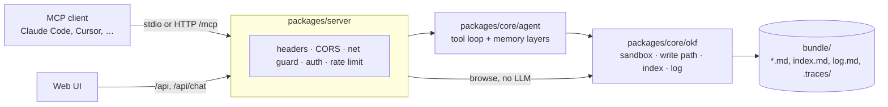

# Architecture

Myzel keeps an AI assistant's long-term memory as a folder of markdown files (a **bundle**)
that follows the [Open Knowledge Format v0.2](https://github.com/GoogleCloudPlatform/knowledge-catalog/blob/main/okf/SPEC.md).
Clients talk to it over MCP. Internally, a small agent decides what to read and write, and a
plain-code layer guarantees that every write leaves a valid bundle.



## 1. Packages and the dependency rule

| Package | Role |
|---|---|
| `packages/core` | Library with no server dependencies. `src/okf` is deterministic (no LLM); `src/agent` and `src/providers` hold the LLM layer. |
| `packages/server` | Express 5 app that serves MCP over HTTP, the browse and chat APIs and the built web UI. It also has a stdio MCP entry point. |
| `packages/web` | React 19 single-page app, built by Vite 8 and served by the server in production. |

Imports point one way: `okf ← agent ← server`. The OKF layer never imports the agent, so the
correctness guarantees can be tested without a model or network.

## 2. The deterministic OKF layer (`packages/core/src/okf`)

- **`Bundle`** is the only code that touches the filesystem. It works with bundle-relative paths
  (`/tables/customers.md`). `resolve()` normalizes a path and rejects anything outside the root.
  Content reads and writes also go through `assertRealPathInside()`, which follows symlinks.
- **`KnowledgeBase`** is the only write path. It serializes mutations in a per-process queue. After
  each change it prunes the changed concept's folder chain if that left them holding only their
  `index.md` (folders elsewhere are the user's), regenerates the chain of `index.md` files up to
  the root, appends to `log.md` and optionally commits exactly those files.
- **`frontmatter.ts`** finds the `---` fence and parses its content with the `yaml` package
  (YAML 1.2 core schema), so values keep the type they were written with. Unknown keys are
  allowed (permissive), but only YAML is accepted. Output is written in a form that YAML 1.1
  readers also read back correctly.
- **`git.ts`** runs `GIT_AUTOCOMMIT` and treats the bundle's own `.git` as untrusted (see
  [Security](security.md#bundle-files)).
- **`validate.ts`, `lint.ts`, `graph.ts`** produce the conformance report, the orphan and
  broken-link lists and the link graph. Broken links are warnings, never errors.
- **`atomic.ts`** writes every file to a temp file and renames it into place, so a crash cannot
  leave a half-written file.

## 3. The agent layer (`packages/core/src/agent`)

The agent is a tool loop built on the Vercel AI SDK v7 (`generateText` / `streamText`). It is
capped at `LLM_MAX_STEPS` steps, bounded in time by `LLM_TIMEOUT` and can be cancelled through
`AgentOptions.signal`.

- **Tools** (`tools.ts`): `search_knowledge`, `read_concept` and listing tools for reads;
  `write_concept`, `patch_concept` and `delete_concept` for writes. Every call is recorded in a
  trace.
- **Memory layers for `memory_query`**, tried in order:
  1. the exact cache (`query-cache.ts`), invalidated by a fingerprint of the bundle;
  2. hot memory (`hot-memory.ts`): recent writes and answers, checked with one cheap call;
  3. the full agent run.
- **Dreaming** (`dream.ts`, scheduled by `server/src/dreamer.ts`) is opt-in consolidation. It runs
  only when deterministic signals (orphans, broken links, duplicates, …) say there is work to do.
- **Traces** (`trace.ts`) are stored in `<bundle>/.traces/` and replayed in the graph view, with
  the run's token usage when the provider reports it.
- **Untrusted content** (`untrusted.ts`): every title, description, type, path or log line that is
  placed into a prompt is collapsed to one line and stripped of control and bidi characters.

`packages/core/src/providers` turns `LLM_*` environment variables into an OpenAI-compatible or
Anthropic model, and `agent/model.ts` turns that into the chain each run uses: the primary, an
optional per-call override and the fallback. `withFallback` retries a retryable failure (timeout,
transport error, HTTP 408 or 5xx; 429 only with `LLM_FALLBACK_RETRY_429=true`) against the second
model. Provider errors reach clients only as an HTTP
status (`publicErrorMessage`).

## 4. The server (`packages/server`)

`src/index.ts` only bootstraps: it picks the mode, runs the startup checks and calls
`buildApp()` (`src/app.ts`), which holds the HTTP wiring. A **`MemoryHost`** (`src/host.ts`)
decides which memory a request reaches:

- `singleMemoryHost` — one bundle (`BUNDLE_ROOT`), optionally behind `AUTH_TOKEN`;
- `profileMemoryHost` — one bundle per profile (`PROFILES_ROOT`): the bearer key is looked up in
  the `ProfileRegistry` (`src/profiles.ts`) and selects the memory. Profiles are managed with the
  CLI only (`src/profiles-cli.ts`); there is no HTTP API for them.

Routers are built once per memory and cached by `KnowledgeBase`; each request is dispatched to the
set its memory resolved to. The middleware order in `buildApp()` matters:

1. security headers (CSP, `nosniff`, `Referrer-Policy`); `x-powered-by` is disabled; and
   `trust proxy` when `TRUST_PROXY` is set
2. `/healthz`, which needs no token and touches no memory
3. CORS, which mirrors the network guard's allowlist and never reflects arbitrary origins
4. `express.json` (1 MB limit; per-field limits are in `limits.ts`)
5. **net guard** on `/mcp`, `/api` and `/admin`: an Origin check, plus a Host check on every bind. Loopback
   names always pass; IP literals pass on public binds; any other hostname must be listed in
   `ALLOWED_HOSTS`.
6. **authentication** of `/mcp` and `/api` via the memory host — `AUTH_TOKEN` or a profile
   key, each with the failed-attempt throttle in front (a request with no key is answered 401
   without counting) — which attaches the request's memory
7. **rate limits**: `/mcp` and `/api/chat` (they cost tokens), plus a looser one on the rest of
   `/api`
8. routers, per memory: `/mcp` (a stateless MCP server per request, with the seed cached by
   bundle fingerprint), `GET /api/profile` (which memory the key opened), `/api` browse (no LLM),
   `/api/chat` (streaming, aborted when the client disconnects)
9. `/admin` (with `ADMIN_TOKEN` only), behind the network guard and its own token check with its
   own failure throttle (no rate limit beyond that). It serves `/admin/settings` only. Settings live in `src/settings.ts`: a catalog of the editable settings, and a
   `SettingsStore` that applies `SETTINGS_FILE` over `process.env` at startup (both entry
   points) and writes changes to the file and to `process.env`, which most settings are read from
   on every use.
10. the static web UI (`index.html` at `/` plus its assets; any other path is a 404)
11. a final error handler that logs the error and returns `{ "error": "internal error" }` with no
    stack trace

On SIGTERM or SIGINT the server stops accepting requests, lets running requests finish, and
waits for the mutation queue of every memory it opened to drain (`MemoryHost.drain()`), within
an 8-second deadline.

`src/mcp/seed.ts` builds the overview of the memory that MCP clients receive at session start.
It is sent both in the `instructions` field and in the `memory_query` tool description.

## 5. The web UI (`packages/web`)

- `App.tsx` loads the tree, the conformance report, the log and the config, and supplies the
  content of the three panels: **Explorer** (search and tree), **View** (concept, log or graph)
  and **Agent chat**. The chat's state (a `Chat` instance) is created in `App`, so it survives the
  panel remounts that layout changes cause.
- `GraphView.tsx` draws the link graph with d3-force and replays recorded query paths.
- `MarkdownRenderer.tsx` renders concept bodies with remark-gfm and rehype-sanitize, and
  highlights code with Shiki. `MermaidDiagram.tsx` draws ```` ```mermaid ```` blocks; Mermaid loads
  with the first diagram, not with the app.
- `api.ts` keeps the optional bearer token in `sessionStorage` (for the life of the tab) and
  attaches it to every request.

### The workspace layout

The panels sit in resizable columns that users rearrange by drag and drop. How to use it is
described in the [README](../README.md#the-web-ui); the implementation is split in two:

- **`src/layout.ts`** is the model. It is made of plain functions with no React in them
  (`movePanel`, `shiftPanel`, `togglePanel`, `visibleSizes`, `parseLayout`), and it is
  unit-tested in `test/layout.test.ts`. The layout (column order, closed panels, widths in
  percent) is saved per browser in `localStorage` under `myzel-layout`. `parseLayout` checks
  everything read back, and any problem falls back to the default.
- **`src/components/Workspace.tsx`** renders the model with `react-resizable-panels` v4
  (`Group` / `Panel` / `Separator`):
  - **Drag and drop** uses the native HTML5 API with a private MIME type
    (`application/x-myzel-panel`), so text or files dragged in from outside are ignored.
    While a panel is being dragged, a transparent shield covers the other panels; without it,
    inputs, links or the graph canvas inside them would swallow the drop.
  - **The keyboard** path is the ← / → buttons in each title bar. Separators are focusable and
    resize with the arrow keys.
  - **Panel order is fixed at mount**, so the `Group` is re-keyed when the order changes, and the
    widths come back through `defaultLayout`.
  - **Widths are saved only after user interaction**, and the *requested* layout is stored, so a
    temporarily narrow window does not overwrite the widths the user chose.

To add a panel:

1. Add its id to `PANEL_IDS` and `DEFAULT_LAYOUT.order`, and give it a width in
   `DEFAULT_LAYOUT.sizes` (`src/layout.ts`). Keep the default widths adding up to 100.
2. Add a `PanelSpec` (title, minimum width in px, content) to `panels` in `App.tsx`, and a label
   to `PANEL_LABELS`.

Once the new id exists, layouts saved before it no longer list every panel, so `parseLayout`
rejects them and those users get the default layout once.
